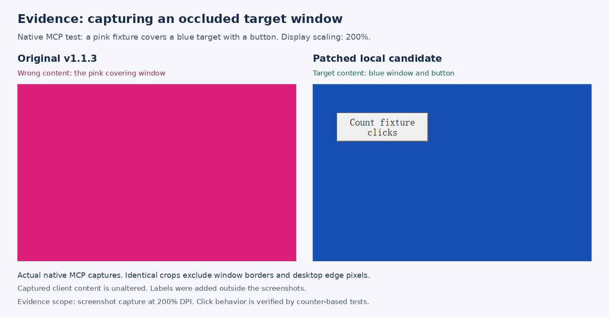

# Windows target capture and posted clicks

Windows screenshots use `PrintWindow(PW_RENDERFULLCONTENT)` on the same top-level
HWND used by the accessibility snapshot. The bitmap includes the full window, so
screenshot coordinates remain physical pixels relative to `GetWindowRect`,
including at 200% display scaling. An occluding application's pixels are not used
as a fallback. Capture validates geometry before and after rendering; failed
captures omit the image while retaining available accessibility information.
The existing bridge process timeout bounds an unresponsive renderer to 30 seconds.

`click_method=app_post`, and the posted fallback of `auto`, resolve the deepest
visible native child inside the requested window and convert the point to that
child's client coordinates. They do not use desktop `WindowFromPoint`, which
would select the occluder. Disabled controls, cross-process descendants,
out-of-client-area coordinates, stale window/element geometry, child movement between clicks, and failed
`PostMessage` delivery are refused. Use accessibility actions for window chrome.
The global pointer path remains explicitly opt-in.

## Limits

`PrintWindow` relies on the application rendering its window. Hardware-accelerated,
protected or otherwise unsupported surfaces may still return blank/incomplete
content even when the API reports success. This change does not claim universal
Windows capture support or verify that every pixel is up to date.

Successful `PostMessage` means the message was queued, not that the application
performed its intended action. Some owner-drawn WinForms controls, custom canvases
and other toolkits ignore background mouse input or require actual cursor/focus
state. Prefer the control's UI Automation action where available and verify the
result with another observation. This fix neither injects a semantic button
notification nor silently activates the target to work around that behavior.

## Reproduce and verify

From the repository root on an interactive Windows desktop:

```powershell
go -C apps/OpenComputerUseWindows test ./...
go -C apps/OpenComputerUseWindows build -o ../../.build/ocu-target.exe .
powershell.exe -NoProfile -File scripts/tests/windows-target.test.ps1 -RuntimePath apps/OpenComputerUseWindows/runtime.ps1
powershell.exe -NoProfile -File scripts/tests/windows-target-smoke.ps1 -NativePath .build/ocu-target.exe
```

To demonstrate the original defects with a v1.1.3 binary, run the same native
smoke script with `-ExpectOriginal`. The fixture creates its own WinForms target,
nested panel, native-style button and topmost occluder; it never operates on user
documents and closes its own process in `finally`.

| Check at 200% DPI | v1.1.3 | Patched runtime |
| --- | --- | --- |
| Covered target's sampled background | Occluder RGB `220,30,120` | Target RGB `20,80,180` |
| Posted left mouse-up reaches nested button | Counter stays at 0 | Counter increments |
| `auto` native-style button click under cover | Not covered by the baseline assertion | Click counter increments |
| Posted right click and nested panel click | Not covered by the baseline assertion | Counters increment |
| Disabled control, stale window/element geometry, invalid point | Not covered by the baseline assertion | Explicit refusal |
| Minimized target | Existing image omission | Image still omitted |

The regression distinguishes a raw mouse-up counter from the button's semantic
Click counter. An owner-drawn control receiving a mouse message is not evidence
that it accepted a click. Foreground/cursor observations are logged separately
because a person may use the desktop during the multi-second MCP requests. The
production-function fault tests provide no global pointer/focus methods, so any
such call in the posted path fails that test.

## WPF observation validation

The complete existing WPF/native MCP/CLI/Worker JS observation smoke passes on
the tested Windows desktop after correcting its PowerShell 5.1 and localization
assumptions: preserve single-image arrays, match the fixture's stable name rather
than the localized `edit` role, and encode JSON-RPC input explicitly as UTF-8.
The initial "missing image" failure was a harness assertion error: diagnostics
showed one actual image while the scalar object's Count property was null.

Coverage includes selective channels, stale-index rejection and AX recovery,
real Unicode value updates, and image omission/recovery for 1x1, minimized and
cloaked windows. The Worker JS path also passes. These results do not establish
support for every Windows toolkit or renderer.

## Display scale and screenshot evidence

Desktop occlusion and posting to the wrong HWND are not specific to a display
scale. The native tests here ran at 192 DPI (200%); The maintainer
[hosted regression](https://github.com/iFurySt/open-computer-use/actions/runs/42350802353)
also passed at 96 DPI (100%). 150% and mixed-DPI monitor transitions have not been
independently validated. The fix retains physical
screen/window coordinates rather than applying a fixed scaling factor.



Both panels contain actual native MCP screenshots from the disposable fixture.
The same client-area crop removes window chrome and desktop edge pixels; the
captured content is otherwise unchanged. This image demonstrates capture
behavior; click delivery is checked by the fixture counters.

To save the same privacy-cropped capture while running the native regression,
pass `-EvidencePath <output.png>` to `scripts/tests/windows-target-smoke.ps1`.
The containing directory must exist. Evidence output is opt-in and contains only
the disposable fixture's cropped client region, not raw desktop screenshots.

## Maintainer review on current main

The Windows workflow also builds the pinned v1.1.4 baseline and runs the same
fixture with `-ExpectOriginal`, proving that the old binary returns the occluder
pixels and misses child mouse-up events. The candidate must return target pixels
and increment independent counters. Both cropped fixture captures are uploaded.
Production-function tests additionally cover child movement without changing the
top-level HWND, movement between repeated clicks, and interruption after down.
Hosted results and actual DPI are recorded in the PR review history.


The hosted run passed the original/candidate pixel and event-counter comparison,
plus the existing WPF, native MCP/CLI/Worker JS, input and tree-budget regressions.
The first covered posted click changed the foreground HWND despite unchanged
cursor coordinates. No explicit activation is performed by this path, but the
receiving application may change focus; background delivery is not a guarantee
of an unchanged foreground window.
